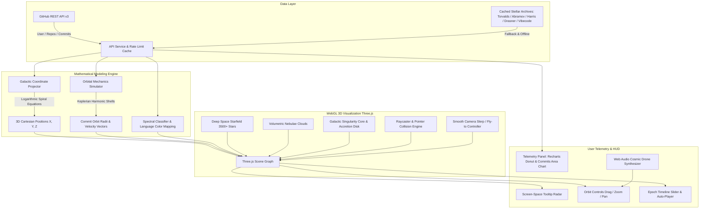

# 🌌 GitHub Contribution Galaxy

> An interactive 3D WebGL cosmos turning your GitHub repositories and open-source contribution history into a living, navigable galaxy.

[](https://opensource.org/licenses/MIT)
[](https://www.typescriptlang.org/)
[](https://threejs.org/)
[](https://react.dev/)
[](https://tailwindcss.com/)

---

## 🔭 Overview

**GitHub Contribution Galaxy** visualizes software engineering portfolios as astronomical structures. Rather than standard flat contribution heatmaps or tabular repositories, each codebase is projected as a star system within a multi-arm logarithmic spiral galaxy. 

- **Repository Stars:** Each repository is an illuminated stellar core sized logarithmically by total commits and star popularity, classified into astrophysical spectral tiers ($O, B, A, F, G, K, M$) and tinted according to its primary programming language.
- **Commit Satellites:** Individual commits orbit their host stars in Keplerian planetary shells, with orbital inclination, angular velocities, and radii calculated from chronological commit sequences.
- **Galactic Core:** The developer's profile forms a supermassive luminous core with a relativistic accretion disk radiating gravitational influence across the galactic arms.
- **Temporal Replay:** A timeline engine replays the cosmic evolution of the portfolio from the developer’s earliest repository creation epoch to the present day.
- **Procedural Audio Synthesizer:** Built-in Web Audio API synthesizer generates a warm 55Hz harmonic cosmic drone with interactive frequency-gliding warp effects when navigating systems.

---

## 🏗️ System Architecture



---

## 📐 Mathematical Coordinate Projections

### 1. Logarithmic Spiral Galactic Arm Projection
Galactic arms follow the logarithmic spiral formula observed in spiral galaxies like NGC 1232 and the Milky Way:

$$r(\theta) = a \cdot e^{b \cdot \theta}$$

Where:
- $a = 14.0$ (Core galactic exclusion radius)
- $b = 0.28$ (Spiral tightness expansion coefficient)
- $\theta \in [0.15 \cdot 2.5\pi, 1.95 \cdot 2.5\pi]$ (Radial azimuthal sweep)

To distribute $N$ repositories across $K = 3$ symmetric spiral arms with realistic stellar dispersion:

$$\theta_k = \theta + \frac{2\pi \cdot k}{K}$$

$$r_{\text{dispersed}} = \max\left(8.0, r(\theta) + \delta_r\right), \quad \delta_r \sim \mathcal{U}(-6.0, 6.0)$$

Cartesian $(x, y, z)$ coordinates on the galactic plane:

$$x = r_{\text{dispersed}} \cdot \cos\left(\theta_k + \frac{\delta_\tau}{r_{\text{dispersed}}}\right)$$

$$z = r_{\text{dispersed}} \cdot \sin\left(\theta_k + \frac{\delta_\tau}{r_{\text{dispersed}}}\right)$$

$$y = z_0 \cdot \exp\left(-\frac{r_{\text{dispersed}}}{h_r}\right) \cdot \sin(i \cdot 7.1)$$

Where $h_r = 140$ is the radial scale length, establishing a thick galactic central bulge that tapers smoothly toward the disc edges.

---

### 2. Keplerian Orbital Mechanics for Commits
Individual commit satellites orbit their parent star at radius $r_i$ in accordance with Kepler's Third Law approximation:

$$v(r_i) = \frac{\kappa}{\sqrt{r_i}}$$

$$\theta_i(t) = \theta_{0, i} + \omega_i \cdot t$$

$$\begin{cases}
x_i(t) = X_{\text{star}} + r_i \cos(\theta_i(t)) \\
z_i(t) = Z_{\text{star}} + r_i \sin(\theta_i(t)) \\
y_i(t) = Y_{\text{star}} + r_i \sin(\theta_i(t)) \sin(\iota_i)
\end{cases}$$

Where $\iota_i \in [-15^\circ, +15^\circ]$ models the orbital inclination angle relative to the planetary plane.

---

### 3. Stellar Radius & Spectral Classification
Star cluster radius $R$ is scaled logarithmically to prevent hyperscale repositories from overwhelming the viewport:

$$R = \text{clamp}\left(1.8, 8.0, \; 1.6 + 1.5 \cdot \log_{10}(\text{commits} + 2 \cdot \text{stars} + 1)\right)$$

| Spectral Class | Visual Color Temperature | Radius Range ($R$) | Typical Activity Profile |
| :--- | :--- | :--- | :--- |
| **Class O** | Electric Cyan / Blue Supergiant | $R > 6.0$ | Flagship codebases (>10k stars, >10k commits) |
| **Class B** | Deep Cosmic Blue | $5.0 < R \le 6.0$ | High-throughput frameworks & runtimes |
| **Class A** | Brilliant White | $4.2 < R \le 5.0$ | Production tools & active libraries |
| **Class F** | Yellow-White | $3.4 < R \le 4.2$ | Maintained services and packages |
| **Class G** | Sol-Yellow (Sun-like) | $2.6 < R \le 3.4$ | Stable utility repos and applications |
| **Class K** | Amber Orange | $2.0 < R \le 2.6$ | Specialized scripts and micro-modules |
| **Class M** | Deep Crimson Red Dwarf | $R \le 2.0$ | Compact experiments, gists, and seeds |

---

## 📊 Data Schema & Validation

| Field | Source Type | Model Output | Validation Rule / Fallback |
| :--- | :--- | :--- | :--- |
| `username` | `login` (string) | `string` | Lowercased, alphanumeric with dashes |
| `position` | Calculated $[x, y, z]$ | `[number, number, number]` | Guaranteed finite, non-NaN 3D vector |
| `coreRadius` | Stars + Commits | `number` | Clamped between $1.8 \le R \le 8.0$ |
| `languageColor` | `language` string | Hex code `#RRGGBB` | Mapped via GitHub linguist dictionary; `#60a5fa` fallback |
| `commits` | Size / Stars / Events | `CommitNode[]` | Bounded to 60 orbital bodies for sustained 60 FPS |
| `rateLimit` | HTTP Status 403 / 429 | Automatic fallback | Transparently hydrates verified offline archive |

---

## 🚀 Embedding in GitHub Profile READMEs

You can embed your 3D Contribution Galaxy into your personal GitHub profile README or portfolio website:

### 1. Markdown Badge (Click to open Galaxy)
Add the following snippet to your `README.md`:

```markdown
[](https://TheRollerBlader.github.io/github-contribution-galaxy/?user=YOUR_USERNAME)
```

### 2. Web Portfolio / Blog `<iframe />`
```html
<iframe
  src="https://TheRollerBlader.github.io/github-contribution-galaxy/?user=YOUR_USERNAME&autoplay=1"
  width="100%"
  height="650"
  style="border: 1px solid rgba(56, 189, 248, 0.25); border-radius: 16px; background: #030712;"
  allow="autoplay"
  loading="lazy"
></iframe>
```

### Supported URL Query Parameters
- `user`: GitHub username (e.g., `?user=torvalds`)
- `repo`: Automatically zoom and fly camera to target repository upon load (e.g., `?user=torvalds&repo=linux`)
- `autoplay`: Start epoch timeline player automatically (`?autoplay=1`)

---

## 💻 Local Development & Build

### Prerequisites
- Node.js `v18.0.0` or higher
- npm or yarn

```bash
# 1. Clone the repository
git clone https://github.com/TheRollerBlader/github-contribution-galaxy.git
cd github-contribution-galaxy

# 2. Install dependencies
npm install

# 3. Start local development server (with HMR)
npm run dev

# 4. Compile production build
npm run build

# 5. Preview production build locally
npm run preview
```

---

## 🛡️ License
Released under the [MIT License](LICENSE). Built with cosmic energy by TheRollerBlader.
